<p align="center">
  
</p>

# hitorro-unittime

Micro-benchmarking and performance profiling toolkit for measuring Java operation execution times with nanosecond precision.

## Overview

The hitorro-unittime module provides a framework for measuring the cost of primitive Java operations, data structure operations, and custom code blocks. It carefully accounts for JVM overhead (system clock precision, method invocation cost, baseline assignment cost) to produce accurate measurements expressed in milliseconds, nanoseconds, relative units, and estimated CPU instruction cycles.

### Key Capabilities

- **JVM Baseline Calibration** - Measures system clock precision, invocation overhead, and baseline unit cost before benchmarking
- **Adaptive Iteration Scaling** - Automatically scales iteration counts to achieve target measurement accuracy
- **104 Built-In Benchmarks** - Comprehensive coverage of arrays, arithmetic, casting, method invocation, objects, exceptions, threading, and system calls
- **Extensible** - Subclass `UnitTimer` to add custom benchmarks, auto-discovered via classpath scanning
- **CPU Cycle Estimation** - Optional conversion to estimated instruction cycles when CPU GHz is provided
- **Template Method Lifecycle** - `init()` -> `preTest()` -> `test()` -> `postTest()` hooks

## Architecture

```mermaid
flowchart TD
    UTC["UnitTimeContext\n(singleton orchestrator)"]

    UTC --> INIT["init(error)\ncalibrates JVM baseline"]
    INIT --> CLOCK["systemClockPrecisionInMsecs"]
    INIT --> INVOKE["invokationOverheadMSecs\n(BaseLineUnitTimer)"]
    INIT --> BASELINE["baseLineUnitCostMSecs\n(LocalAssignment)"]

    UTC --> GETTESTS["getTests()\nclasspatch scan for UnitTimer subclasses"]
    UTC --> EXEC["executeTest(UnitTimer)\nadaptive measurement loop"]
    EXEC --> GC["GC before each iteration"]
    EXEC --> SCALE["Scale iterations until\nruntime >= minExecutionTimeMsecs"]
    EXEC --> SUB["Subtract invocation overhead"]
    EXEC --> RESULT["Produce UnitTimeResult"]

    UT["UnitTimer\n(abstract base)"]
    UT --> PT["PrimitiveTimers\n(category: Datum)"]
    PT --> ARR["ArrayTimers (21)"]
    PT --> CAST["CastTimers (8)"]
    PT --> MATH["MathTimers (23)"]
    PT --> INV["InvokeTimers (31)"]
    PT --> OBJ["ObjectTimers (5)"]
    PT --> EXC["ExceptionTimers (5)"]
    PT --> THR["ThreadTimers (5)"]
    PT --> SYS["SystemCalls (4)"]
    UT --> BL["BaseLineUnitTimer\n(hidden no-op)"]
```



### Core Classes

| Class | Purpose |
|-------|---------|
| `UnitTimer` | Abstract base class. Subclass and implement `test()` to measure an operation. |
| `UnitTimeContext` | Singleton orchestrator. Calibrates JVM baseline, discovers tests via classpath scanning, runs benchmarks with adaptive iteration scaling. |
| `UnitTimeResult` | Result container with `milliSecondsPerUnit`, `nsPerUnit`, `units` (relative to baseline), `instructionCycles`, `category`, `subCategory`, `description`, `unitClass`, and `error`. |
| `PrimitiveTimers` | Abstract intermediate base for all primitive benchmarks (category: "Datum"). |
| `BaseLineUnitTimer` | Hidden no-op timer for measuring method invocation overhead. |

## Dependencies

| Dependency | Version | Purpose |
|-----------|---------|---------|
| hitorro-core | 3.0.1 | ClassPathDeepIterator, ClassUtil, StringUtil, Fmt, Log |
| junit | 4.13.2 | Testing (test scope) |
| mockito-core | 5.7.0 | Mocking (test scope) |

### Maven Coordinates

```xml
<dependency>
    <groupId>com.hitorro</groupId>
    <artifactId>hitorro-unittime</artifactId>
    <version>3.0.1</version>
</dependency>
```

## Building

```bash
# Build the module (from the hitorro root)
mvn clean install -pl hitorro-unittime

# Build without tests
mvn clean install -pl hitorro-unittime -DskipTests

# Build with all transitive dependencies
mvn clean install -pl hitorro-unittime -am

# Deploy to local Maven repo
./build-and-deploy.sh --clean
```

## Testing

```bash
# Run all tests
mvn test -pl hitorro-unittime

# Run a specific test class
mvn test -pl hitorro-unittime -Dtest=MapGetTest

# Run a specific test method
mvn test -pl hitorro-unittime -Dtest=MapGetTest#testMapGetPerformance
```

### Test Coverage

| Test Class | Coverage |
|-----------|----------|
| `MapGetTest` | HashMap.get operations: creation, existing/missing keys, types, empty map, null key, performance, consistency |
| `UnitTimerTest` | UnitTimer construction, getters/setters, defaults, visibility, lifecycle methods |
| `UnitTimeResultTest` | Result field initialization, toString, error handling |

## Usage

### Running All Benchmarks

```java
UnitTimeContext context = UnitTimeContext.getUnitTimeContext();
List<UnitTimeResult> results = context.runAll(3.2); // CPU GHz for cycle estimation

for (UnitTimeResult result : results) {
    System.out.printf("%-40s %10.4f ns  %8.2f units  %8.1f cycles%n",
        result.description, result.nsPerUnit, result.units, result.instructionCycles);
}
```

### Running Filtered Benchmarks

```java
UnitTimeContext context = UnitTimeContext.getUnitTimeContext();

// Filter by name or category (case-insensitive)
List<UnitTimeResult> arrayResults = context.runFiltered("array", 3.2);
List<UnitTimeResult> mathResults = context.runFiltered("math", 3.2);
```

### Listing Categories

```java
UnitTimeContext context = UnitTimeContext.getUnitTimeContext();
List<String> categories = context.getCategories();
// ["Datum", ...]

int count = context.getTimerCount();
// ~92 visible timers
```

### Creating a Custom Benchmark

```java
public class MyOperationTimer extends UnitTimer {
    private MyObject obj;

    public MyOperationTimer() {
        super("My custom operation");
        setIterations(100); // operations per test() call
    }

    @Override
    public String getCategory() { return "Custom"; }

    @Override
    public String getSubCategory() { return "MyOps"; }

    @Override
    public void init() {
        obj = new MyObject();
    }

    @Override
    public void preTest() {
        obj.reset();
    }

    @Override
    public void test() throws Exception {
        for (int i = 0; i < 100; i++) {
            obj.doOperation();
        }
    }
}
```

Custom timers placed in a package starting with `com.hitorro.unittime.` are auto-discovered. For other packages, register them with `context.addPackagePrefix("com.mypackage.")`.

## Measurement Methodology

### Baseline Calibration

Before any benchmarks run, three calibration measurements are taken:

1. **System clock precision** - How granular is `System.currentTimeMillis()`? (typically 1-15ms)
2. **Invocation overhead** - Cost of calling `test()` with an empty body (`BaseLineUnitTimer`)
3. **Baseline unit cost** - Cost of a local `int` assignment (`LocalAssignment`), treated as ~1 CPU instruction

### Adaptive Iteration Scaling

For fast operations that complete in less than the minimum execution time:
1. If runtime < 10x clock precision, double the iteration count
2. Otherwise, estimate iterations needed: `target / (runtime - clockPrecision) * currentN`
3. Overflow protection prevents integer wrap-around

### Result Calculation

```
individualCallTime = (totalRuntime / iterations) - invocationOverhead
milliSecondsPerUnit = (individualCallTime / iterationsPerTest) - baseMsecsPerTest
units = milliSecondsPerUnit / baseLineUnitCostMSecs
nsPerUnit = milliSecondsPerUnit * 1_000_000
instructionCycles = nsPerUnit * cpuGigahertz   (if provided)
```

### Error Control

Default target: 0.5% relative error. Minimum execution time = `(1 / error) * clockPrecision`. GC is invoked between measurement iterations to reduce noise.

## Built-In Benchmark Categories

### Array Operations (21 timers)
Array creation, 1D/2D element access, int/double summation loops, fill via for-loop/clone/System.arraycopy, 2-way and 4-way dependency-breaking loop unrolling.

### Arithmetic (23 timers)
Add/subtract/multiply/divide for int, long, float, double (local and member variables). Comparisons (greater-than, equals). `Math.abs()`, `Math.min()`, `Math.sqrt()`.

### Method Invocation (31 timers)
Empty and non-empty calls with 0-4 arguments. Abstract method dispatch, interface dispatch, virtual method overrides, final methods. Reflective invocation. Getter/setter pairs (int and Integer).

### Type Casting (8 timers)
String/interface casting from Object. Primitive conversions (byte->double, double->int). Array access with byte index conversion.

### Object Operations (5 timers)
Object instantiation (10-field class), casting, `instanceof`, `HashMap.get()`.

### Exception Handling (5 timers)
Try-catch overhead (with/without exception), try-finally, throws clause, exception throwing (20-frame deep).

### Threading (5 timers)
Thread creation+start, join, synchronized block, synchronized method, `Object.wait()`.

### System Calls (4 timers)
`System.currentTimeMillis()`, `System.nanoTime()`, `Thread.sleep()`.

## Design Patterns

- **Template Method** - `UnitTimer` defines lifecycle: `init()` -> `preTest()` -> `test()` -> `postTest()`
- **Strategy** - Each concrete timer is a strategy for measuring a specific operation
- **Singleton** - `UnitTimeContext` with static `getUnitTimeContext()`
- **Reflective Discovery** - `ClassPathDeepIterator` scans classpath for `UnitTimer` subclasses

## License

MIT License - Copyright (c) 2006-2025 Chris Collins
